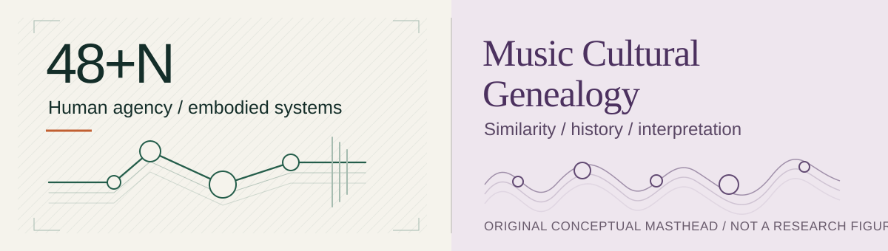

*Research portfolio · Visual edition V6 · Updated 28 October 2026.*

# ANDreaLiuz

**Design Engineering × Robotics × Data Science & AI**

I work on two questions: how can a person remain in charge of a robot that needs to anticipate their actions, and what can data really tell us about relationships between pieces of music? Both projects started as questions I wanted to test in working systems.

My background spans Industrial Design and Robotics Engineering, alongside MSc study in Data Science & AI at the University of the Arts London (UAL). Formal MSc award documentation is pending. My research interests are Physical AI, human–robot interaction, predictive interfaces and design engineering.

## Selected research

### [48+N](https://github.com/ANDreaLiuz/48-plus-n)
**Human specifies the goal. Prediction supplies preparation, not permission.**

48+N is my independently developed, continuing research programme in human-directed embodied intelligence. Shadow studies a bidirectional low-level interaction loop — human corrections, prediction, robot-local response and protection, and feedback. MechaLink studies task meaning, embodiment-aware capability allocation and human-directed revisions during execution. Active supporting work spans RGB-D sensing, recorded-motion evaluation, weak-link questions and bounded SO-101 simulation; a complete physical human-to-robot loop remains a research objective.

[Research overview](https://andrealiuz.github.io/48-plus-n/site/index.html) · [Evidence and limits](https://github.com/ANDreaLiuz/48-plus-n/blob/main/RESEARCH_STATUS.md)

### [Music Cultural Genealogy](https://github.com/ANDreaLiuz/music-cultural-genealogy)
**Mapping Musical Relationships Beyond Genre Labels**

My independent music research investigates acoustic representation, similarity, community structure and the limits of a musical genealogy metaphor. Historical ancestry and natural preference migration remain hypotheses. An explicitly synthetic graph provides a small, offline way to explore the difference between similarity and evidence of lineage.

[Research overview and synthetic explorer](https://andrealiuz.github.io/music-cultural-genealogy/site/index.html) · [Evidence and limits](https://github.com/ANDreaLiuz/music-cultural-genealogy/blob/main/RESEARCH_STATUS.md)

## Research practice

| Area | Work represented here |
|---|---|
| Human-centered systems | Research questions, interface design and the distinction between prediction and human authority |
| Robotics engineering | Sensing integration, recorded-data evaluation and bounded simulated task development |
| Data science | Audio feature representations, graph analysis, statistical interpretation and reproducibility boundaries |
| Research communication | Evidence-linked claims, explicit negative results and careful separation of simulation from physical operation |

## Current work and contribution

I conceived, designed and developed the research represented in these two projects independently, including the project questions, implementation, data collection, experimental operation and interpretation. No other student or faculty researcher co-developed this work. The projects use established tools and open-source resources whose original authors are credited in the individual repositories; I do not claim to have invented those dependencies. The portfolio pages, diagrams and synthetic teaching example were prepared with AI assistance; they do not reproduce the private research implementations.

## Manuscripts in preparation

Two connected robotics research papers are being developed. Shadow is being prepared with IEEE Robotics and Automation Letters (RA-L) as its intended venue; MechaLink is an independent study of task revision and embodiment-aware coordination, with the standalone contribution still under evaluation. These are ongoing research efforts, not submitted or accepted publications.

## Contact

Use my [GitHub profile](https://github.com/ANDreaLiuz) for public contact options. A public email address has not been provided here.

*Research in progress · Public portfolio text prepared 28 October 2026. Repository and GitHub Pages links verified 28 October 2026.*
